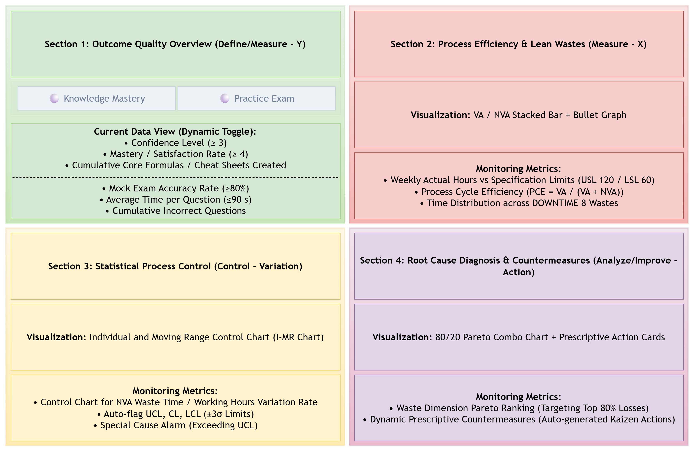

# 📊 Lean Six Sigma DMAIC Learning Operations & Quality Control Tower

[](https://public.tableau.com/views/LSSGBExamPrepOperationsDashboard/1_Executive_DMAIC?:language=en-US&publish=yes&:sid=&:redirect=auth&:display_count=n&:origin=viz_share_link)
[](https://iassc.org/six-sigma-certification/green-belt-certification/)
[](https://docs.google.com/spreadsheets/d/1TSA5N2r6VWVd0ulMDWcjT9Ol1nJfOG4KbNskIW5xVvY/edit?usp=sharing)
[](#-voice-of-customer-voc-to-ctq-matrix)
[](#-milestones--exam-roadmap)

---

## 🎯 Executive Overview & Project Motivation

> [!NOTE]
> **Project Context:**  
> Leveraging a university-sponsored Google Professional Certificate curriculum alongside self-directed Lean Six Sigma Green Belt (LSSGB) certification prep, this project bridges modern Business Intelligence (BI) data engineering with classical Operational Excellence. Recognizing the absence of an institutional Green Belt training track, I developed an autonomous DMAIC continuous improvement engine to govern study throughput, eliminate cognitive waste, and de-risk my first-attempt examination pass.

> [!TIP]
> **Primary Milestone:**  
> First-time certification on the IASSC/CSSC Lean Six Sigma Green Belt exam (Target score $\ge 80\%$) by **January 2027**, adhering strictly to a planned operational budget of **60–120 minutes/week** during Phase 1.

Unlike standard enterprise BI systems designed for cross-functional corporate stakeholders with indefinite transactional data streams, this system functions as a **Single-Operator Agile Quality Control Tower**:
* **Longitudinal & Active Pipeline:** Operates dynamically across a 14-week lifecycle (Stage 1 knowledge mastery through Stage 2 mock sprints).
* **Static Post-Audit Baseline:** Upon certification delivery, data ingestion freezes to serve as a validated historical benchmark.

---

## 🛡️ Methodological Rigor: Overcoming Self-Reporting Bias

A foundational critique of single-operator productivity tracking is the susceptibility to subjective scoring and vanity metrics. In this architecture, data integrity is governed by **Closed-Loop Ground Truth Alignment**:

```
[ Weekly Log: VA / NVA / Confidence ] ──▶ [ DMAIC BI Monitoring ] ──▶ [ OCAP Real-Time Remediation ]
                                                                                   │
[ Certified First-Time Pass ≥ 80% ] ◀──────────────────────────────────────────────┘
            ▲
            └─ Uncompromising Ground Truth Anchor (Zero Tolerance for Vanity Metrics)
```

1. **Output-Anchored Validation:** Purely fabricating favorable intermediate metrics (e.g., artificially deflating non-value-added waste or inflating confidence ratings) yields zero utility when confronted with an objective standardized test. The external examination acts as an uncompromising operational boundary.
2. **Standardized Operational Definitions:** Metrics such as `Confidence_Level`, `PCE`, and `Waste_Type` are bound to rigorous behavioral criteria (e.g., formula articulation thresholds and Lean DOWNTIME taxonomies) rather than subjective intuition.
3. **Statistical Control over Friction:** Special cause variations are actively flagged using Shewhart Statistical Process Control (SPC) principles and Pareto root-cause analysis, routing anomalies directly into Out-of-Control Action Plan (OCAP) countermeasures.

---

## 📐 Voice of the Customer (VOC) to Critical to Quality (CTQ)

> [!IMPORTANT]
> **Voice of the Customer (VOC):**  
> *"I need to master all Green Belt core competencies without destabilizing my graduate academic schedule or generating passive, unretrievable notes."*

| Dimension | Critical to Quality (CTQ) Metric | Target / Specification Limits | Operational Definition |
| :--- | :--- | :--- | :--- |
| **Quality ($Y_1$)** | Confidence Level | $\ge 3.0$ / 5.0 (LSL = 3.0) | Ability to independently state formula conditions and application triggers without references. |
| **Artifact ($Y_2$)** | Deliverable Satisfaction | $\ge 4.0$ / 5.0 (LSL = 4.0) | Weekly cheat sheet module fully synthesized into structured decision rules. |
| **Flow Efficiency** | Process Cycle Efficiency (PCE) | $\ge 70.0\%$ | $\text{PCE} = \frac{\text{VA Min}}{\text{VA Min} + \text{NVA Min}} \times 100\%$ |
| **Capacity ($X$)** | Weekly Total Study Time | $60 \le X \le 120\text{ min}$ (USL = 120) | Prevents cognitive burnout and schedule slippage during regular academic terms. |
| **Output (Stage 2)**| Mock Exam Accuracy | $\ge 80.0\%$ (LSL = 80%) | Passing threshold on 100-question timed simulation sets ($t \le 90\text{ s/Q}$). |

---

## 🔄 System Architecture & Data Flow

Data ingestion and transformation execute on an automated cloud-refresh schedule connecting Google Drive and Tableau Public:

```
┌────────────────────────┐      Daily Cloud Sync      ┌─────────────────────────┐
│   Google Sheets DB     │ ────────────────────────▶ │  Tableau Cloud/Public   │
│ (Fact & Dim Schedules) │                            │ (Extract Refresh Engine)│
└────────────────────────┘                            └─────────────────────────┘
            │                                                      │
            ▼                                                      ▼
┌────────────────────────┐                            ┌─────────────────────────┐
│ Google Drive Security  │                            │ 3-Tab Operational Tower │
│ (OAuth 2.0 Auth Gate)  │                            │  (Executive/Deep/Charter│
└────────────────────────┘                            └─────────────────────────┘
```


*Figure 1: Full System Data Flow Diagram (Built via draw.io)*

> [!NOTE]
> To view the live underlying data structure, access the [Read-Only Google Sheets Data Source](https://docs.google.com/spreadsheets/d/1TSA5N2r6VWVd0ulMDWcjT9Ol1nJfOG4KbNskIW5xVvY/edit?usp=sharing).

---

## 📊 Three-Tab Dashboard Architecture

The operational dashboard is built on an enterprise 3-tab layout structured for cross-level executive insight, deep diagnostic drill-down, and operational governance:

### Tab 1: Executive DMAIC Control Tower
* **Block 1 (Define/Outcome):** Dynamic Sheet Swapping KPI card toggling between **Stage 1 (Confidence & Satisfaction)** and **Stage 2 (Mock Accuracy & Volume)** via parameter controls.
* **Block 2 (Measure):** Lean Flow Analysis tracking weekly Value-Add (VA) vs. Non-Value-Add (NVA) minutes alongside dynamic PCE%.
* **Block 3 (Control):** Individual-Moving Range (I-MR) Statistical Process Control (SPC) chart monitoring process variation, mean center line (CL), and Upper/Lower Control Limits ($\pm 3\sigma$).
* **Block 4 (Analyze/Improve):** Dual-axis Pareto chart identifying the "Critical Few" DOWNTIME wastes, dynamically driving a full-width prescriptive **Kaizen Advice Banner**.

### Tab 2: Process Deep Dive & OCAP
* **Variance Diagnostics:** Box Plot distribution of total cycle time segmented by `Activity_Type` (Notes, Formulas, Calculations).
* **Correlation Modeling:** Linear regression scatter plot correlating `NVA_Min` spikes against `Confidence_Level` drops.
* **OCAP Matrix:** Standardized Out-of-Control Action Plan specifying immediate containment actions when points breach specification limits (USL 120 min, PCE < 60%, or Out-of-Control SPC signals).

### Tab 3: Project Charter & System Blueprint
* Comprehensive operational scope definition (In-Scope vs. Out-of-Scope).
* Timeline roadmap covering Phase 1 (Knowledge Mastery) through Phase 2 (Timed Mock Exam Sprints).
* Embedded draw.io architecture blueprint and CTQ control specifications.

---

## 🚨 Out-of-Control Action Plan (OCAP) Protocols

> [!WARNING]
> When special cause variation is detected in the Control Tower, the following escalation procedures are enacted immediately:

```text
┌──────────────────────┬────────────────────────────────┬──────────────────────────────────────────┐
│ Trigger Condition    │ Immediate Containment          │ Root Cause Diagnostic & Countermeasure   │
├──────────────────────┼────────────────────────────────┼──────────────────────────────────────────┤
│ Weekly Study > 120m  │ Stop session immediately.      │ Inspect Pareto chart for top NVA waste.  │
│ (Breach of USL)      │ No carryover allowed.          │ If Waiting: Restructure AI prompts.      │
│                      │                                │ If Over-processing: Cap notes to 2 pgs.  │
├──────────────────────┼────────────────────────────────┼──────────────────────────────────────────┤
│ PCE < 60% for 2 wks  │ Freeze secondary references.   │ Quarantine digital multitasking.         │
│ (Process Stagnation) │ Restrict intake to CSSC core.  │ Enforce single-piece study flow.         │
├──────────────────────┼────────────────────────────────┼──────────────────────────────────────────┤
│ Confidence < 3.0     │ Halt progression to next topic.│ Tag topic as "Defective" in Schedule.    │
│ (Quality Failure)    │                                │ Execute targeted 30-min DMAIC drill.     │
└──────────────────────┴────────────────────────────────┴──────────────────────────────────────────┘
```

---

## 🗂️ Data Dictionary & Schemas

<details>
<summary><b>🔍 Click to expand Data Dictionary: Fact_Study_Log</b></summary>

| Field Name | Type | Constraints / Format | Description & Operational Definition |
| :--- | :--- | :--- | :--- |
| `Week_Num` | String | `W1` - `W14` | Primary longitudinal timeline index. |
| `Date` | Date | `YYYY-MM-DD` | Date of logged study sprint. |
| `Activity_Type` | String | Categorical | Specific learning action (`Concept_Synthesis`, `CheatSheet_Draft`, `Practice_Drill`, `Mock_Exam`). |
| `VA_Min` | Integer | $\ge 0$ | Value-Add time: Active problem solving, formula retention, and error correction. |
| `NVA_Min` | Integer | $\ge 0$ | Non-Value-Add time: Formatting, administrative overhead, tooling friction, or search delays. |
| `Waste_Type` | String | DOWNTIME Category | Primary Lean waste driver (`Defects`, `Over-processing`, `Waiting`, `Motion`, `Inventory`, etc.). |
| `Confidence_Level` | Integer | Scale: 1 - 5 | Evaluated mastery level against LSSGB syllabus modules. |
| `Satisfaction_Score`| Integer | Scale: 1 - 5 | Quality and modular completeness of weekly synthesized deliverables. |
| `Questions_Attempted`| Integer | Null (Phase 1) / $\ge 0$ (Phase 2) | Total questions completed during mock sprint. |
| `Questions_Correct`  | Integer | Null (Phase 1) / $\ge 0$ (Phase 2) | Total correctly answered questions. |

</details>

<details>
<summary><b>🔍 Click to expand Data Dictionary: Dim_Schedule</b></summary>

| Field Name | Type | Description |
| :--- | :--- | :--- |
| `Week_Num` | String | Foreign key matching `Fact_Study_Log.Week_Num`. |
| `DMAIC_Phase` | String | DMAIC stage alignment (`Define`, `Measure`, `Analyze`, `Improve`, `Control`, `Sprint_Drill`, `Mock_Exam`). |
| `POBOK_Topic` | String | IASSC / CSSC syllabus section classification (e.g., `1.1`, `5.2`). |
| `POBOK_Topic_Description` | String | Module title and specific tools covered in the curriculum. |
| `Key_Focus_Items` | String | Targeted practical artifacts (e.g., SIPOC, Box-Cox, I-MR selection logic). |
| `Standard_Planned_Min` | Integer | Planned operational budget (120 min for Phase 1; 600 min for Phase 2 sprints). |

</details>

---

## 🛠️ Tech Stack & Implementation Details

* **Analytics & Visualization:** Tableau Desktop / Tableau Public (Calculated Fields, Dual-Axis Visualizations, Level of Detail (LOD) Expressions, Sheet Swapping Containers).
* **Data Layer:** Google Sheets (Relational star-schema design with dimensional lookups).
* **Process Modeling:** draw.io / Mermaid.js (System architecture, Swimlane diagrams, and VSM mapping).
* **Methodological Standards:** IASSC POBOK, CSSC Lean Six Sigma Green Belt Body of Knowledge.

---

## 👤 Author & Acknowledgments

* **Analyst / Process Owner:** Graduate Student & Continuous Improvement Practitioner
* **Curriculum Foundations:** University Google Professional Certificate Sponsorship & Council for Six Sigma Certification (CSSC) Open Resources.
* **Interactive Dashboard:** [View Live on Tableau Public](https://public.tableau.com/views/LSSGBExamPrepOperationsDashboard/1_Executive_DMAIC?:language=en-US&publish=yes&:sid=&:redirect=auth&:display_count=n&:origin=viz_share_link)
